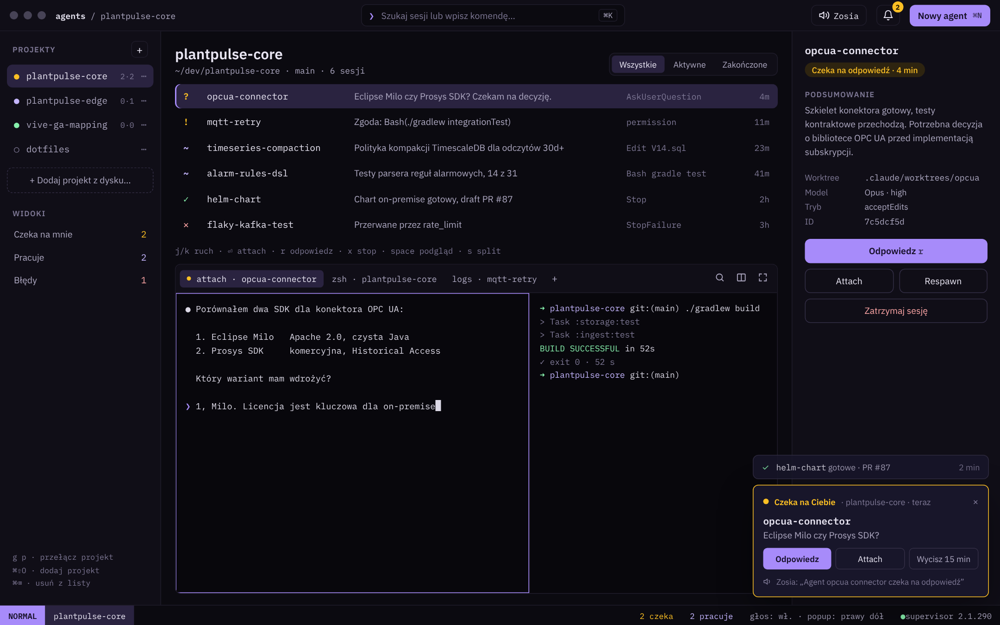

# Agent Manager

Natywna aplikacja na macOS 15 Sequoia+ do zarządzania lokalnymi agentami Claude Code: projekty, sesje, stany, terminal i powiadomienia (popup + głos) w jednym oknie. Kotlin + Compose Desktop, nakładka na supervisor sesji Claude Code.

Dokumentacja koncepcyjna: [docs/README.md](docs/README.md).
